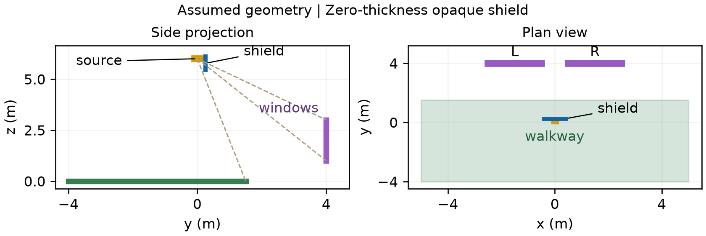
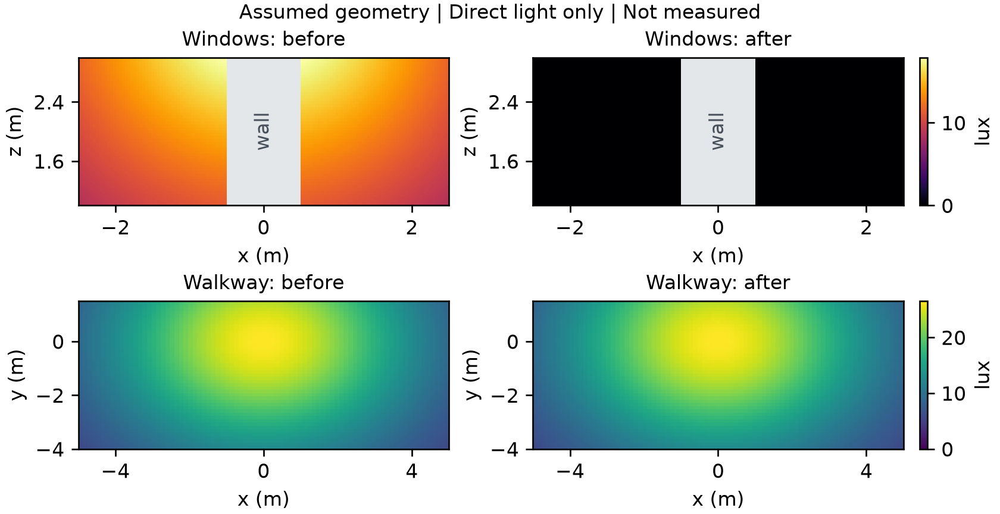

# 빛경계: 직접광 조도 비교 실험

하향 발광하는 유한 면적 광원과 직사각형 차광판을 가정하여, 두 창면과 보행면에 도달하는 직접광 조도를 차광 전후로 계산합니다. 입력값을 바꾸면 같은 코드로 배치와 차광판 크기를 비교할 수 있습니다. 별도의 서버·API·유료 서비스는 사용하지 않습니다.

## 재현

Python 3.12에서 실행했습니다. 빈 가상환경을 만들고 고정한 의존성을 설치한 뒤 다음 명령을 실행합니다.

```bash
python -m venv .venv
# Windows PowerShell
.venv/Scripts/Activate.ps1
# macOS / Linux
# source .venv/bin/activate
python -m pip install -r requirements.txt
python run_checks.py
python run.py
python sweep.py
```

`run_checks.py`는 물리 모델 14개 검사와 별도의 합성 각도 구간 8개 검사를 실행합니다. `run.py`는 조도·격자 수렴성·그림을 만들고, `sweep.py`는 차광판 하단 높이 다섯 값을 비교합니다. 기본 계산은 일반 CPU에서 수십 초 정도 걸리며, 실행 환경에 따라 달라집니다.

## 입력과 수식

기본 배치는 `inputs.json`에 있습니다. 길이 단위는 m, 광속은 lm, 조도는 lx입니다.

| 항목 | 가정값 |
|---|---|
| 광원 | 중심 (0, 0, 6), 0.24 × 0.16m, 하향 한 면의 총광속 3,000lm |
| 광원 법선 | (0, 0, -1) |
| 창 L / R | y=4, z=1~3, x=-2.5~-0.5 / 0.5~2.5 |
| 창면 법선 | (0, -1, 0) |
| 보행면 | z=0, x=-5~5, y=-4~1.5, 법선 (0, 0, 1) |
| 차광판 | y=0.25, x=-0.4~0.4, z=5.45~6.1 |
| 기본 소스 격자 | 31 × 31개 동일 면적 패치의 중점 |
| 수광 격자 | 각 창 51 × 51, 보행면 81 × 45개의 동일 크기 셀 중심 |

균일한 한 면 Lambertian 광원의 면적을 A, 총광속을 Φ라 하면 휘도는 `L = Φ / (π A)`입니다. 동일 면적 패치 N개의 각 패치에 배정한 광속은 `dΦ = Φ / N`이고, 한 센서에서 계산하는 조도는 다음과 같습니다.

```text
E = Σ visibility × (Φ / (π N)) × cos_source × cos_receiver / distance²
```

두 코사인은 음수를 0으로 제한합니다. 패치 면적은 광속 배분에 이미 반영되므로 면적을 다시 곱하지 않습니다. `visibility`는 광원 패치에서 센서까지의 **유한 선분**과 차광판의 교차로 정하며, 센서 너머 또는 광원 뒤의 판은 가림으로 처리하지 않습니다. 판의 경계는 보수적으로 불투명하게 취급하고, 가려진 광속을 다른 방향으로 다시 배분하지 않습니다.

이 실험은 **가정한 형상의 직접광 수치계산이며 현장 측정이 아닙니다.** 차광판은 두께 0의 불투명 흡수판으로, 반사광·다른 광원·실제 등기구 배광·유리 투과·눈부심·열·풍하중·방수·전기 안전은 계산하지 않습니다. 창의 값은 **외부 창면에 입사하는 연직 조도**이며 실내 조도가 아닙니다. 결과는 설계안 비교에 쓰며 법적 위반 여부를 판정하지 않습니다.

## 기본 결과

| 수광면 | 전 최소 / 평균 / 최대(lx) | 후 최소 / 평균 / 최대(lx) | 평균 감소율 | 최소 점별 유지율 |
|---|---|---|---|---|
| 창 L | 8.62669 / 12.80969 / 17.89071 | 0 / 0 / 0 | 100% | 0% |
| 창 R | 8.62669 / 12.80969 / 17.89071 | 0 / 0 / 0 | 100% | 0% |
| 보행면 | 5.96803 / 16.07054 / 26.51449 | 5.96803 / 16.07054 / 26.51449 | 0% | 100% |

평균은 동일 크기 수광 셀 중심의 산술평균으로 계산한 영역평균의 중점 근사입니다. 최소 점별 유지율은 각 점의 `차광 후 / 차광 전` 비율 중 가장 작은 값이며, 두 최솟값을 나눈 값과 다릅니다. 선택한 기본 형상에서는 창으로 향하는 직접광이 모두 판에 가려지고 보행면 광선은 유지됩니다. 아래 변형 실험에서는 보행면을 함께 가리는 실패 사례도 나타납니다.



그림 1. `inputs.json`에서 생성한 형상입니다. 왼쪽은 측면 **투영**이므로 x=0 단면에 실제 창이 있다는 뜻이 아닙니다.



그림 2. 가정한 배치의 직접광 계산 결과이며 실측값이 아닙니다. 같은 수광면의 전후 그림은 같은 색상 범위를 사용합니다. 창 사이 회색 영역은 수광 창면에 포함하지 않은 벽입니다.

## 차광판 높이 비교

`sweep.py`는 다른 값을 고정한 채 판의 하단 높이만 바꿉니다. 선택한 다섯 후보의 비교이며 최적 설계라는 의미는 아닙니다.

| 판 하단 z(m) | 창 평균(lx), 좌우 동일 | 창 평균 감소율 | 보행면 평균 유지율 | 보행면 최소 점별 유지율 |
|---|---:|---:|---:|---:|
| 5.00 | 0 | 100% | 98.72367% | 57.77069% |
| 5.45 | 0 | 100% | 100% | 100% |
| 5.65 | 0.56407 | 95.59656% | 100% | 100% |
| 5.80 | 9.80933 | 23.42260% | 100% | 100% |
| 5.90 | 12.80969 | 0% | 100% | 100% |

5.00m까지 내려온 판은 보행면 평균의 작은 변화와 달리 일부 점의 조도를 크게 줄입니다. 따라서 평균값만으로 보행면 영향을 판단하지 않습니다. 입력을 수정한 뒤 README의 고정 예시 표도 최신 CSV와 맞춰 갱신해야 합니다.

## 검증과 수렴성

- 해석 검산: 점광원 극한, 3-4-5 삼각형의 두 코사인 인자, 광속 비례, 점광원 역제곱 관계를 확인합니다.
- 가림 검산: 완전 가림·비가림·부분 가림, 판 가장자리, 유한 선분 밖 교차, 광원과 판의 충돌을 확인합니다. 모든 수광점에서 흡수판을 둔 뒤 조도가 증가하지 않는지도 확인합니다.
- 광원 격자: 같은 수광 격자를 유지하여 13/21/31 격자의 조도 차이를 lx로 비교합니다.
- 수광 격자: 광원 격자를 31로 고정하고 각 수광면을 31/61/91 격자로 바꾸어 영역평균 근사를 비교합니다.
- 부분 가림 제어: 설계 입력과 독립적인 고정 대칭 광원과 판을 사용하여 광원의 절반을 가립니다. 이 제어의 전체 좌표는 `results.json`의 `partial_control_inputs`에 저장됩니다. 13/21/31 홀수 격자는 판 경계와 겹치는 중앙 열 때문에 편향이 남습니다. 32/64 짝수 격자는 대칭에 따른 0.5 유지비를 별도로 확인합니다.

0lx인 차광 후 값에 상대오차를 적용하지 않으며, 격자 간 차이와 부분 가림 제어의 오차를 따로 저장합니다. 계산 단계의 검사는 전술한 모델 구현에 대한 검사입니다.

기본 배치에서 확인한 작은 격자 오차를 부분 차폐가 있는 다른 설계에 일반화하지 않습니다. 독립 검토에서 광원 격자를 31에서 64로 늘렸을 때, 하단 5.00m 판의 보행면 최소 유지율은 약 57.77%에서 57.52%로, 하단 5.65m 판의 창면 평균은 약 0.5641lx에서 0.5662lx로 달라졌습니다. 하단 5.80m 판은 창면 평균이 약 9.8093lx에서 9.8170lx로 바뀌었고 최소 유지율은 약 37.99%에서 39.89%로 달라졌습니다. 표의 기본 sweep 값은 31 × 31 광원 격자 결과이며, 새 설계를 판단할 때는 해당 설계의 부분 차폐 경계를 더 세밀한 격자로 다시 확인해야 합니다.

## 파일

| 파일 | 내용 |
|---|---|
| `model.py` | Lambertian 패치 합산, 유한 선분 차폐, 수광 격자·지표 |
| `run.py` | 기본 장면과 소스·수광 격자 수렴성, 열지도·배치도 |
| `sweep.py` | 차광판 높이 5개 후보 비교 |
| `geometry.py` | 기존 2D 합성 방향각 구간 판정, 조도 계산과 별개 |
| `test_model.py`, `run_checks.py` | 물리 모델 검사와 합성 각도 검사 실행 |
| `comparison.csv`, `results.json` | 기본 수치와 계산 설정·버전 |
| `parameter_sweep.csv` | 높이별 결과 |
| `results/convergence.json` | 광원·수광 격자 수렴성과 부분 차폐 제어 |
| `results/illuminance_fields.npz` | NumPy로 열 수 있는 전후 수광 격자 전체 값 |
| `test-results.json`, `geometry-results.json` | 실행한 검사 결과 |

원문 서류, 신청 정보, 서명, 개인 연락처는 이 저장소에 포함하지 않습니다. AI가 코드·문서 작성을 도왔습니다. MIT 라이선스는 이 저장소에서 작성한 코드에 적용하며, NumPy·Matplotlib 등 외부 라이브러리의 라이선스를 대체하지 않습니다.

## 공학·법학·행정·주민 생활의 연결

[통합 연구 설명](docs/legal-admin.md)에서 실제 서울시 빛 공해 재정 사례와 낮 일조권의 구별, 주민 기록·공학 비교·행정 확인·분쟁 조정의 연결을 설명합니다. 법령·사건 원문은 해당 문서의 공식 출처 링크에서 확인할 수 있습니다.

## 물리 모델의 참고 문헌

- [PBRT 4판: Area Lights](https://pbr-book.org/4ed/Light_Sources/Area_Lights): 한쪽 면적 Lambertian 광원의 출력 정규화.
- [PBRT 4판: Radiometry](https://pbr-book.org/4ed/Radiometry,_Spectra,_and_Color/Radiometry): 거리와 입사각에 따른 광량의 관계.
- [Radiance 용어집](https://radsite.lbl.gov/radiance/book/glossary.html): 조도·광속·휘도 단위의 구별.

수식을 참고하여 직접 구현했으며 PBRT나 Radiance의 코드·도표를 복제하지 않았습니다.
